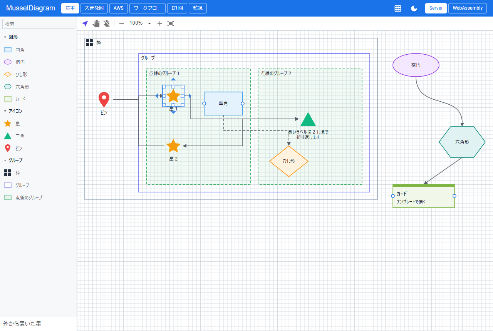
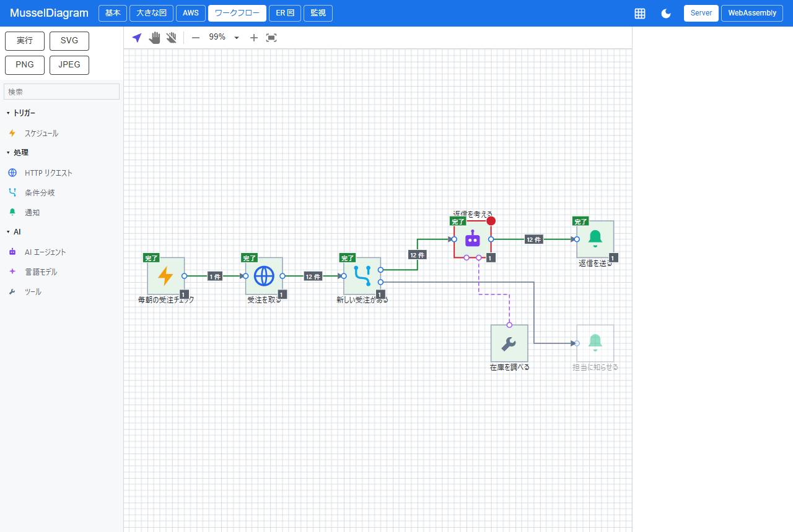
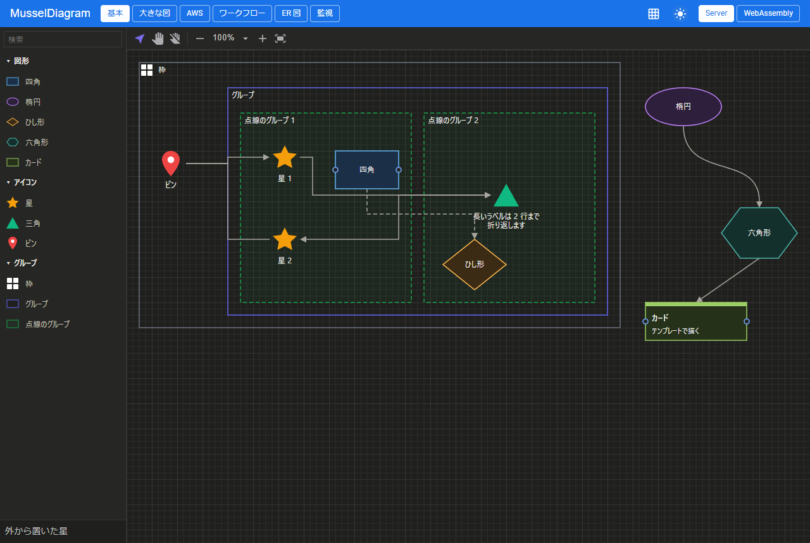

# MusselDiagram - Diagram editor for Blazor

[](https://www.nuget.org/packages/MusselDiagram/)

## 🐚 What is this?

A diagram editor for Blazor, made to be built into applications.  
Types and rules decide what can be placed where and what can be connected, and a model without UI checks and saves the diagram on servers too.  

| 🧩 Editing | 🏷️ States and issues | 🌙 Dark theme |
|:-:|:-:|:-:|
|  |  |  |

## 🚀 Quick Start

Link the stylesheet in the page head.  

```html
<link rel="stylesheet" href="_content/MusselDiagram/MusselDiagram.css" />
```

Register the types, create a `Diagram` and show it in an interactive component.  

```razor
@page "/"
@using MusselDiagram

@if (view is not null)
{
    <MusselDiagramPalette View="view" />
}
<MusselDiagramView @ref="view" Diagram="diagram" Connected="OnConnected" />

@code {
    private static readonly DiagramSchema Schema = new()
    {
        NodeTypes =
        [
            new DiagramNodeType
            {
                Name = "server",
                DisplayName = "Server",
                Ports = [new DiagramPortDefinition { Id = "out", Direction = DiagramPortDirection.Out, Side = DiagramSide.Right }]
            },
            new DiagramNodeType
            {
                Name = "database",
                DisplayName = "Database",
                Look = new DiagramLook { Shape = DiagramShape.Ellipse },
                Ports = [new DiagramPortDefinition { Id = "in", Direction = DiagramPortDirection.In, Side = DiagramSide.Left }]
            }
        ],
        LinkTypes = [new DiagramLinkType { Name = "arrow" }],
        DefaultLinkType = "arrow"
    };

    private readonly Diagram diagram = new(Schema);

    private MusselDiagramView? view;

    protected override void OnAfterRender(bool firstRender)
    {
        if (firstRender)
        {
            StateHasChanged();
        }
    }

    private void OnConnected(DiagramConnectedEventArgs e) => Console.WriteLine($"{e.Source.ElementId} -> {e.Target.ElementId}");
}
```

The diagram works without a view as well: `diagram.Validate()` checks the whole diagram, and `diagram.ToJson()` and `diagram.LoadJson(json)` save and load it.  
The `Example` project shows every feature on Server and WebAssembly: a sample of shapes, groups and lines, a large office network, and sample apps for workflows, ER diagrams, device monitoring, electrical single-line diagrams and AWS architecture diagrams.  

## 🎨 Look

| Part | Detail |
|---|---|
| Theme | CSS variables shared with the Mussel family (`--mussel-primary-text` and more), `--mussel-diagram-*` for the diagram, and `.mussel-dark` for dark backgrounds |
| Types | Rectangles, ellipses, diamonds and paths, icons, colors, strokes and dashes, presets, group headers and label slots with formats |
| Templates | Razor templates for node types that need their own drawing |
| Grid | Dots or lines behind the diagram |
| States | Selection, connection candidates, drop targets, errors and warnings, and states and badges of the app as overlays |

## ✅ Supported features

| Category | Detail |
|---|---|
| **Model** | Nodes, ports, links, tree groups, overlay groups that cross other groups, shared items, typed data, queries, undo and redo, and JSON with versions |
| **Rules** | Connection rules by port, direction, kind and type, nesting, counts, permissions, locks, app rules and whole-diagram checks |
| **Editing** | Move, resize, connect and reconnect, snapping and guides, box selection or panning by dragging the background, align and distribute, order, copy and paste, group and ungroup, and text editing in place |
| **Routes** | Orthogonal routes around obstacles, straight and curved lines, and a router that can be replaced |
| **Palette** | Categories, search, dragging from the palette and from lists of the app, dropping on links, quick add by keys, and icon sets from Iconify JSON, zip files and folders, with large sets read icon by icon when shown |
| **Commands** | A registry of commands with keys for toolbars and menus of the app |
| **Export** | SVG, PNG and JPEG, with images and fonts embedded |
| **Touch** | Pan, pinch zoom, long press and dragging from the palette |
| **Languages** | English and Japanese built in, others as data of the same shape |
| **Hosting** | Interactive Server, WebAssembly (also trimmed) and Auto; the core also runs without UI and with Native AOT |

## ☁️ AWS architecture diagrams

The Example shows how to draw AWS architecture diagrams with the official icons.  
The icons are not included. Download them and place them in the Example:  

1. Download the "Icon package" zip from [AWS Architecture Icons](https://aws.amazon.com/architecture/icons/).
2. Extract the SVG files into `AwsIcons/` at the root of the repository. Git ignores the folder.
3. Build and run the Example. The build copies the service, resource and group icons to the output folder, and the AWS page reads each icon when it is shown.

A zip can also be chosen with the file button on the page.  
Copy `Example.Client/Models/AwsDiagrams.cs` to use the same group looks, arrows and rules in an application.  

## 📖 API

See the [API reference](Document/API.md) and the [specification](Document/SPEC.md).  

## 🌊 Mussel family

- [MusselChart](https://github.com/usausa/mussel-chart) - Charts
- [MusselSheet](https://github.com/usausa/mussel-sheet) - Input sheet
- [MusselCalendar](https://github.com/usausa/mussel-calendar) - Calendar
- [MusselDiagram](https://github.com/usausa/mussel-diagram) - Diagram editor
